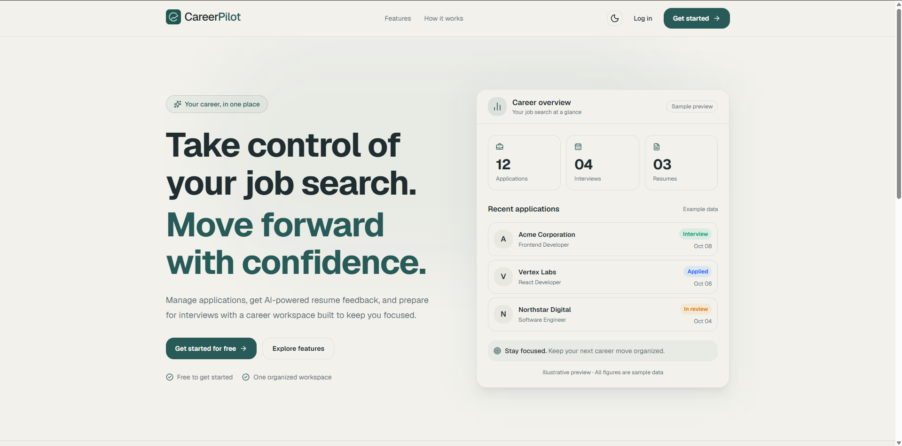
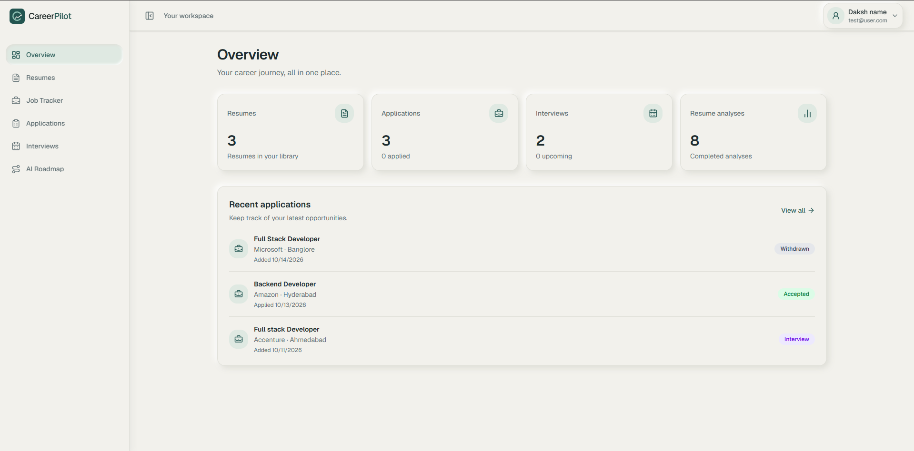
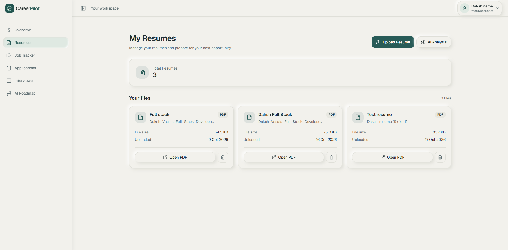
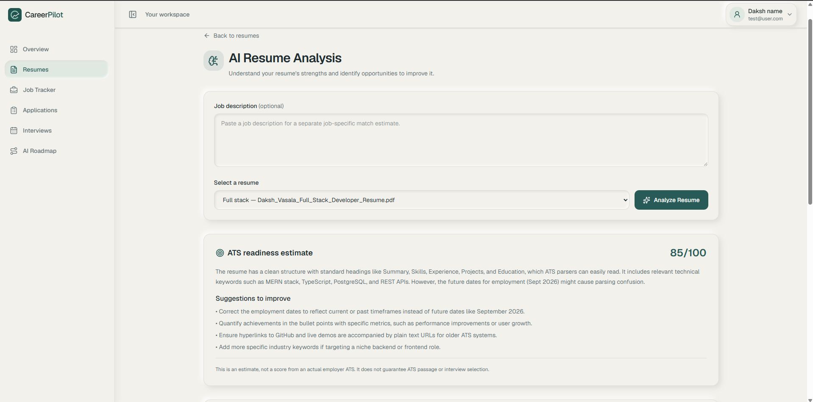
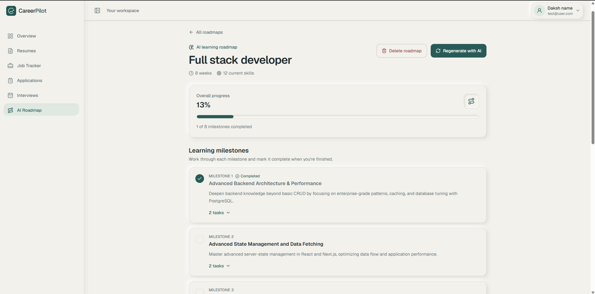

<p align="center">
  
</p>

<h1 align="center">CareerPilot</h1>

<p align="center">
  A full-stack career management platform for organizing applications,
  tracking interviews, and improving career decisions with AI.
</p>

<p align="center">
  <a href="https://career-pilot-psi-two.vercel.app/"><strong>Live demo →</strong></a>
</p>



## Live demo

[Open CareerPilot →](https://career-pilot-psi-two.vercel.app/)

### Demo account

- Email: `test@test.com`
- Password: `test1234`

The demo account is intended for recruiters and reviewers to explore CareerPilot. Please do not enter personal or confidential information.

> The backend is hosted on Render, so the first request after a period of inactivity may take a moment to respond.

## Screenshots



<p align="center">
  
  
</p>



## Key features

| Feature | What it does |
| --- | --- |
| Dashboard | Applications, interviews, and resumes at a glance |
| AI resume analysis | Gemini-powered feedback on an uploaded PDF resume |
| Job application tracking | Follow each role through its stages |
| Interview tracking | Keep dates, rounds, and notes together |
| AI-assisted career roadmaps | AI-generated next steps toward a target role |
| Authentication | Secure sign in to access your workspace |
| Profile management | Keep your details and preferences up to date |
| Dark mode | Light and dark themes |

## Tech stack

**Frontend**

- Next.js (App Router)
- React
- TypeScript
- Tailwind CSS

**Backend**

- Node.js
- Express 5
- TypeScript
- Drizzle ORM

**Database**

- Neon (PostgreSQL)

**External services**

- Google Gemini API: AI resume analysis and career roadmaps
- Cloudinary: resume file storage
- Resend: transactional email
- Vercel: frontend deployment
- Render: backend deployment

## Architecture

```
Next.js frontend (Vercel)
        │
        ▼
Express API (Render) ──► Neon PostgreSQL (via Drizzle ORM)
        │
        ├──► Cloudinary   (resume PDFs)
        ├──► Gemini API   (AI analysis and roadmaps)
        └──► Resend       (email)
```

## Challenges solved

**Resume upload failing from Google Drive on mobile.**
Files picked from Drive failed with `net::ERR_UPLOAD_FILE_CHANGED` because the browser held a stale handle to the Drive-backed file. The fix was to read the file into memory with `arrayBuffer()` at selection time and upload that in-memory copy instead of the original handle. File type is also validated by extension and PDF header bytes (`%PDF`), since Drive files can arrive with an empty MIME type.

## Local setup

1. Clone the repository and install dependencies in both app directories.

   ```bash
   git clone https://github.com/Daksh-Vasala/CareerPilot.git
   cd CareerPilot
   cd frontend && npm install
   cd ../backend && npm install
   ```

2. Create the required environment files in each app directory using the variable names listed below.

3. Run database migrations in `backend/`.

   ```bash
   cd backend
   npm run db:migrate
   ```

4. Start both apps in two separate terminals.

   ```bash
   # Terminal 1
   cd frontend
   npm run dev

   # Terminal 2
   cd backend
   npm run dev
   ```

The frontend runs on `http://localhost:5000` and the backend runs on `http://localhost:3000` by default.

AI resume analysis, resume upload, and email flows require the related external services to be configured (`GEMINI_API_KEY`, `CLOUDINARY_*`, and `RESEND_API_KEY`).

## Environment variables

**Backend** (`backend/.env`)

```env
PORT=
DEBUG=
DATABASE_URL=
JWT_SECRET=
JWT_EXPIRES_IN=
CLOUDINARY_API_SECRET=
CLOUDINARY_API_KEY=
CLOUDINARY_CLOUD_NAME=
GEMINI_API_KEY=
GEMINI_MODEL=
RESEND_API_KEY=
FRONTEND_URL=
```

**Frontend** (`frontend/.env.local` or equivalent)

```env
BACKEND_API_URL=
NEXT_PUBLIC_API_URL=   # fallback used by the frontend helper when BACKEND_API_URL is not set
```

## Project structure

```
CareerPilot/
├── backend/             Express API, Drizzle schema and migrations
├── frontend/            Next.js app
├── docs/
│   └── screenshots/     README images
└── README.md
```

## Author

**Daksh Vasala**

- GitHub: [Daksh-Vasala](https://github.com/Daksh-Vasala)
- LinkedIn: [Daksh Vasala](https://www.linkedin.com/in/daksh-vasala/)
